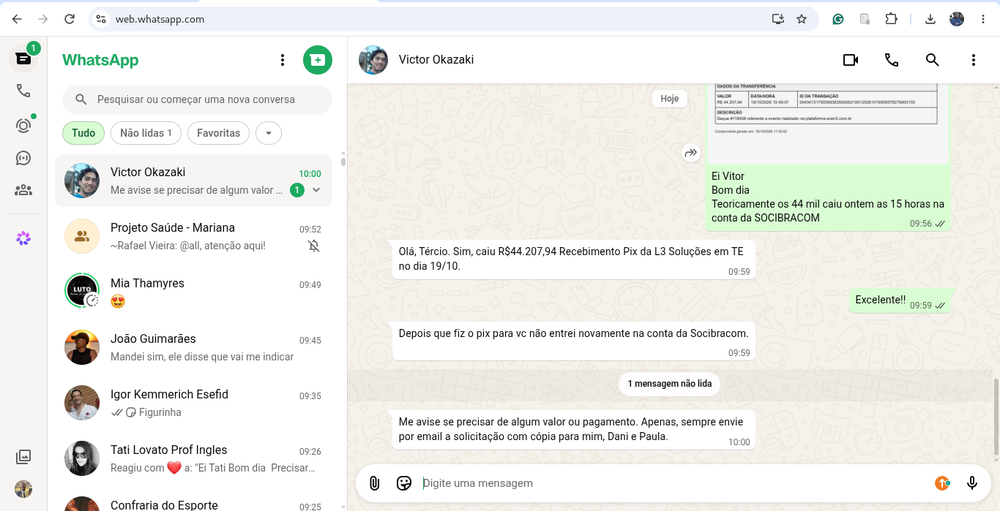
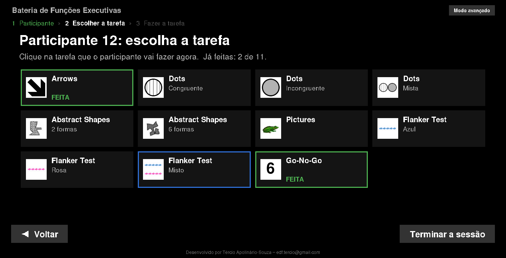
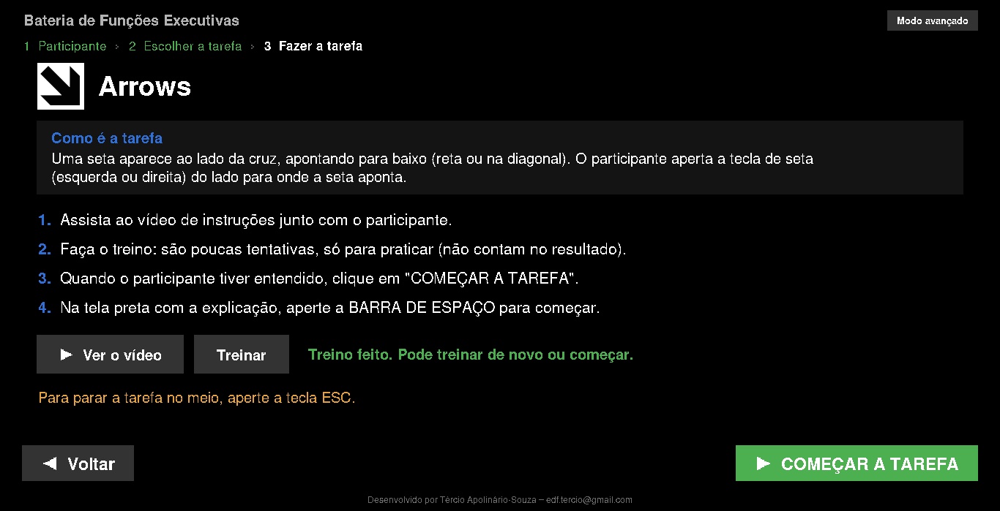
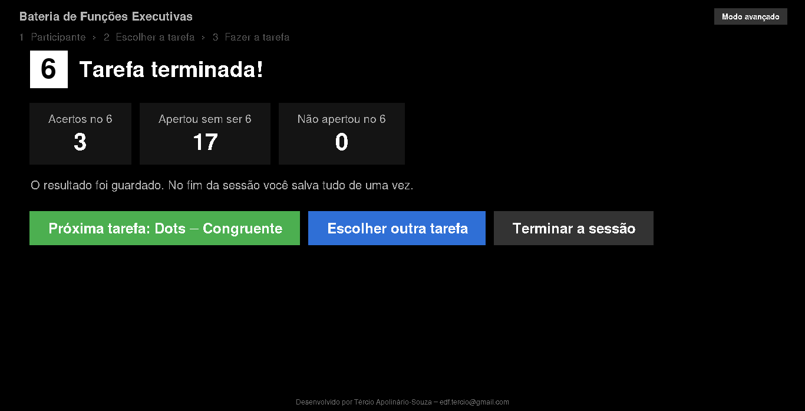
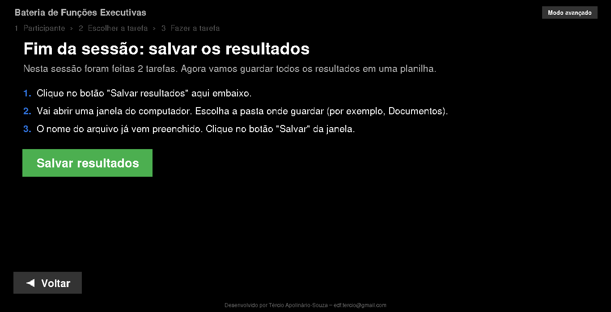
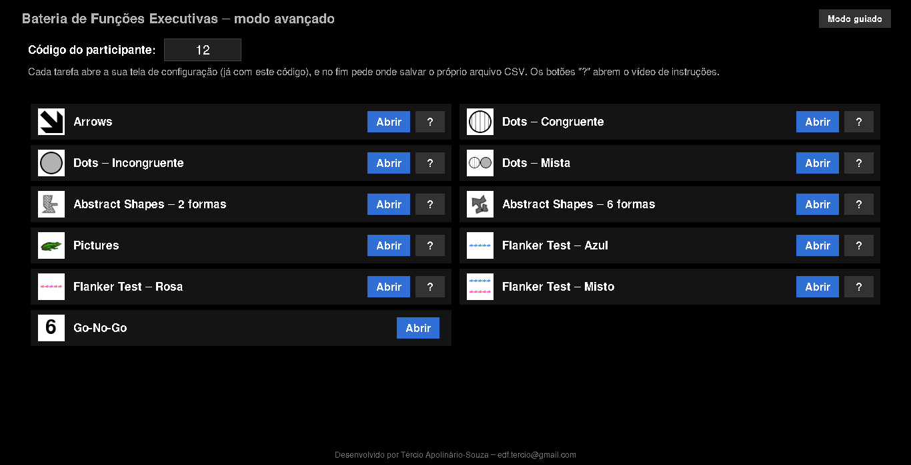

# Bateria de Testes de Funções Executivas

🌐 [Read this in English](README.en.md)

Coleção de tarefas computadorizadas (Python + Pygame) para avaliação de
funções executivas: tempo de reação, inibição, flexibilidade cognitiva e
efeito Simon/flanker. Cada tarefa roda em tela cheia, grava as respostas do
participante e, ao final, processa e salva um resumo automaticamente. Um
menu com **modo guiado** conduz a sessão passo a passo para quem tem pouca
familiaridade com computador.

## Instalação (Windows)

### 1. Baixar o programa

1. Nesta página do GitHub, clique no botão verde **Code** e depois em
   **Download ZIP**.
2. Abra a pasta **Downloads**, clique com o botão direito no arquivo
   `.zip` e escolha **Extrair tudo...** → **Extrair**.
   **Não rode o programa de dentro do `.zip`**: use sempre a pasta extraída.

### 2. Instalar

1. Verifique se o computador está conectado à internet.
2. Na pasta do programa, abra `Instalar_Win` e dê dois cliques em
   **`instalacao.bat`**. (Se o Windows avisar "O Windows protegeu o
   computador", clique em **Mais informações** → **Executar assim mesmo**.)
3. Aguarde — a janela mostra o andamento sozinha, não precisa clicar em
   nada. Quando aparecer **"Instalação concluída com sucesso!"**, aperte
   qualquer tecla: o programa abre sozinho.

Isso instala (se ainda não estiverem instalados) o Python 3.11 e as
bibliotecas `numpy`, `pygame`, `pandas` e `openpyxl`, e cria o ícone
**Bateria de Funções Executivas** na área de trabalho e no menu Iniciar.
Das próximas vezes, é só dar dois cliques nesse ícone (ou em
`INICIAR_BATERIA.bat`, na pasta do programa).

Se algo der errado, o script mostra uma mensagem em português explicando o
problema e como tentar de novo — veja também
`Instalar_Win/Passo_a_passo_intalacao_requisitos.txt`.

## Usar o programa

### Modo guiado

O programa abre no **modo guiado**, feito para quem tem pouca familiaridade
com computador: uma coisa por tela, letras e botões grandes, e os botões
**Voltar** e **Continuar** sempre no mesmo lugar.

1. **Participante** — digite o código do participante (uma vez só para a
   sessão inteira).

   

2. **Escolher a tarefa** — um cartão para cada tarefa/condição, com uma
   imagem da própria tarefa. As já feitas na sessão ficam marcadas com
   **FEITA**.

   

3. **Fazer a tarefa** — a tela explica a tarefa em palavras simples e tem
   os botões **Ver o vídeo** (instruções), **Treinar** (algumas tentativas
   de familiarização, que não contam) e **COMEÇAR A TAREFA**. Na tela da
   tarefa, a barra de espaço começa e a tecla **ESC** interrompe.

   

4. Ao terminar, aparecem os acertos e erros e o botão para ir à **próxima
   tarefa** da lista.

   

5. **Terminar a sessão** — todos os resultados vão para **uma planilha
   só** (`.xlsx`), salva onde você escolher: a aba **Sessão** tem uma linha
   por tarefa (acertos, erros, sem resposta) e há uma aba para cada tarefa
   com o resumo completo. Se tentar fechar o programa sem salvar, ele
   avisa.

   

O programa também avisa antes de refazer uma tarefa que o participante já
fez (nesta sessão ou numa anterior), porque os dados novos substituem os
antigos.

### Modo avançado

O botão **Modo avançado**, no canto superior direito, mostra todas as
tarefas numa tela só. Cada tarefa abre a sua própria **tela de
configuração** (número de tentativas, tempo de apresentação, interstímulo
etc.), já preenchida com o código do participante, e no fim pede onde
salvar o CSV com o resumo daquela tarefa. Os botões **?** abrem o vídeo de
instruções. O botão **Modo guiado** volta para o passo a passo.

## Como rodar uma tarefa avulsa

Também é possível abrir cada tarefa sem passar pelo menu: cada
tarefa/variante fica em sua própria pasta dentro de `Tarefas/`, com um
arquivo **`Executable.bat`** — dê dois cliques nele para abrir a tarefa.
O fluxo é o mesmo do modo avançado:

1. **Tela de configuração** — preencha o código do sujeito e os parâmetros
   da sessão. Há dois botões: **Começar**, que roda a coleta com esses
   parâmetros, e **Familiarização**, que roda só um bloco curto de
   tentativas de treino (sem salvar CSV) para o participante praticar
   antes da coleta valendo — ao terminar, a tela de configuração volta
   para você clicar em Começar.
2. **Tela de instruções** — mostra o mapeamento estímulo → tecla; o
   participante aperta a **barra de espaço** para iniciar (ESC sai).
3. **Tentativas** — a tarefa roda sozinha até o fim e fecha automaticamente
   (ESC interrompe).
4. **Resultados** — a tarefa processa os dados desse sujeito e abre uma
   janela para você escolher onde salvar o CSV com o resumo (acertos,
   erros, antecipações, omissões, tempo de resposta, e — quando aplicável —
   custo de congruência/mudança).

## As tarefas

| Tarefa | Pastas/variantes |
|---|---|
| Arrows | (pasta única) |
| Dots | `congruent`, `incongruent`, `mixed` |
| Abstract Shapes | `two_shapes`, `six_shapes` |
| Pictures | (pasta única) |
| Flanker Test | `azul`, `rosa`, `mixed` |
| Go-No-Go | `tarefa_manual` |

### Arrows (`Tarefas/Arrows`)

Uma seta aparece de um dos lados da cruz central, apontando para baixo em
linha reta ou na diagonal. A resposta correta depende do lado da tela em
que a seta aparece (efeito Simon), com metade das tentativas congruentes e
metade incongruentes.

### Dots (`Tarefas/Dots`)

Círculos de pontos (listrados ou sólidos/cinza) aparecem à esquerda ou à
direita. Regra: **listrado = mesmo lado, sólido = lado oposto**. Três
condições:
- **congruent** — só estímulos listrados (regra sempre "mesmo lado");
- **incongruent** — só estímulos sólidos (regra sempre "lado oposto");
- **mixed** — listrado e sólido intercalados, exigindo alternar a regra a
  cada tentativa.

### Abstract Shapes (`Tarefas/Abstract_Shapes`)

Tarefa de escolha forçada de duas alternativas: uma forma abstrata aparece
à esquerda ou à direita da tela e o participante responde com a tecla
correspondente (seta esquerda/direita). Existem duas variantes: **2
formas** (uma forma por lado) e **6 formas** (três formas distintas por
lado), com trocas pseudoaleatórias de estímulo entre tentativas. Nesta
tarefa, a Familiarização roda 6 tentativas (em vez de 4) quando a variante
"6 formas" está selecionada, para garantir que toda forma apareça ao menos
uma vez no treino.

### Pictures — efeito Simon (`Tarefas/Pictures`)

Um sapo ou uma borboleta aparece à esquerda ou à direita. Borboleta = tecla
esquerda; sapo = tecla direita, independente do lado em que a imagem
aparece (congruente quando a imagem aparece do lado que "combina" com a
tecla certa).

### Flanker Test (`Tarefas/Flanker_Test`)

Tarefa de flanker com peixinhos: uma fileira de 5 peixes aparece na tela e
o participante responde à direção para onde aponta o peixe **central**,
ignorando os peixes ao redor (congruentes quando todos apontam para o
mesmo lado, incongruentes quando o central diverge). Três condições:
`azul` (só a versão azul), `rosa` (só a versão rosa) e `mixed` (mistura
as duas, alternando entre elas de tentativa em tentativa). Tem uma tela
extra de feedback (rosto feliz/triste) depois de cada resposta, com
duração configurável na tela de configuração (pode zerar).

### Go-No-Go (`Tarefas/Go-No-Go/tarefa_manual`)

Tarefa auditiva: números de 1 a 9 aparecem na tela e são reproduzidos em
áudio, e o participante aperta a **barra de espaço** somente para o número
6 (go), sem responder aos demais (no-go). O resumo traz acertos no 6,
omissões, falsos alarmes (apertou sem ser 6), rejeições corretas e o tempo
de reação médio no 6; a planilha tentativa a tentativa fica em
`tarefa_manual/<código>_resultados.xlsx`.

## Onde ficam os dados

Cada tarefa/variante grava os dados brutos por tentativa em sua própria
pasta `trials/` (arquivos `SUJ<código>_trial<N>.csv`), junto com a
sequência de estímulos da sessão (`sequence.csv`) e a legenda dos códigos
de estímulo/resposta (`legend.txt`). O Go-No-Go grava
`<código>_resultados.xlsx` na pasta `tarefa_manual`. O resumo processado é
salvo onde você escolher: uma planilha única por sessão no modo guiado, ou
um CSV por tarefa no modo avançado e nas tarefas avulsas.

Os dados de participantes **não vão para o GitHub**: o `.gitignore` deixa
de fora os arquivos `trials/SUJ*.csv`, `Arrows/sujeitos/` e os resultados
do Go-No-Go. Eles ficam só no computador da coleta — faça backup deles.

Scripts de análise em lote (todos os sujeitos de uma vez) ficam em
`processar_dados/`.

## Contato

Tércio Apolinário-Souza — edf.tercio@gmail.com
