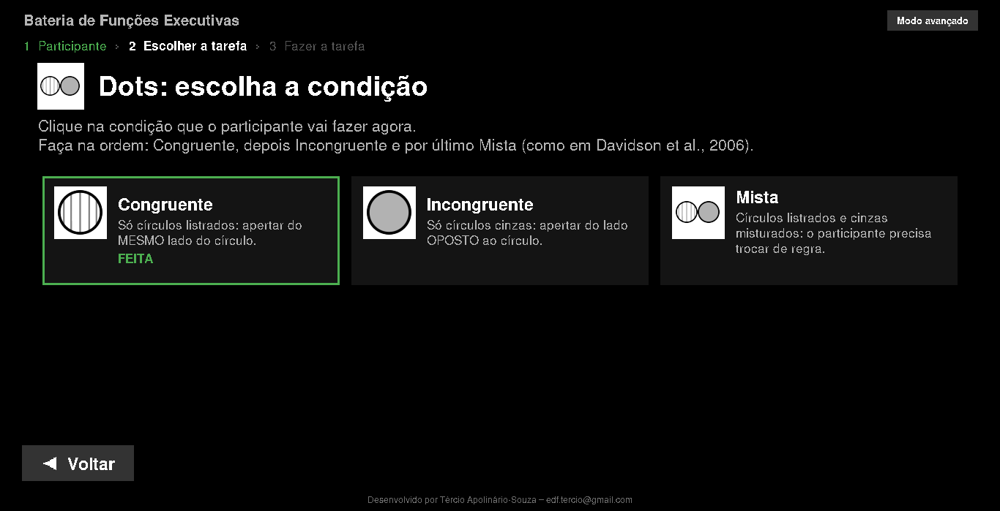

# Bateria de Testes de Funções Executivas

🌐 [Read this in English](README.en.md)

Coleção de tarefas computadorizadas (Python + Pygame) para avaliação de
funções executivas: tempo de reação, inibição, flexibilidade cognitiva e
efeito Simon/flanker. Cada tarefa roda em tela cheia, grava as respostas do
participante e, ao final, processa e salva um resumo automaticamente. Um
menu com **modo guiado** conduz a sessão passo a passo para quem tem pouca
familiaridade com computador.

## Instalação (Windows)

### 1. Baixar o programa

1. Nesta página do GitHub, clique no botão verde **Code** e depois em
   **Download ZIP**.
2. Abra a pasta **Downloads**, clique com o botão direito no arquivo
   `.zip` e escolha **Extrair tudo...** → **Extrair**.
   **Não rode o programa de dentro do `.zip`**: use sempre a pasta extraída.

### 2. Instalar

1. Verifique se o computador está conectado à internet.
2. Na pasta do programa, abra `Instalar_Win` e dê dois cliques em
   **`instalacao.bat`**. (Se o Windows avisar "O Windows protegeu o
   computador", clique em **Mais informações** → **Executar assim mesmo**.)
3. Aguarde — a janela mostra o andamento sozinha, não precisa clicar em
   nada. Quando aparecer **"Instalação concluída com sucesso!"**, aperte
   qualquer tecla: o programa abre sozinho.

Isso instala (se ainda não estiverem instalados) o Python 3.11 e as
bibliotecas `numpy`, `pygame`, `pandas` e `openpyxl`, e cria o ícone
**Bateria de Funções Executivas** na área de trabalho e no menu Iniciar.
Das próximas vezes, é só dar dois cliques nesse ícone (ou em
`INICIAR_BATERIA.bat`, na pasta do programa).

Se algo der errado, o script mostra uma mensagem em português explicando o
problema e como tentar de novo — veja também
`Instalar_Win/Passo_a_passo_intalacao_requisitos.txt`.

## Usar o programa

### Modo guiado

O programa abre no **modo guiado**, feito para quem tem pouca familiaridade
com computador: uma coisa por tela, letras e botões grandes, e os botões
**Voltar** e **Continuar** sempre no mesmo lugar.

1. **Participante** — digite o código do participante (uma vez só para a
   sessão inteira).

   

2. **Escolher a tarefa** — um cartão para cada tarefa, com uma imagem da
   própria tarefa. As já feitas na sessão ficam marcadas com **FEITA**
   (ou "1 de 3 feitas", nas tarefas com mais de uma condição).

   

   Dots, Abstract Shapes e Flanker Test têm mais de uma condição: ao
   clicar, abre uma página para escolher qual fazer, com uma frase
   explicando cada uma e a ordem recomendada (Dots: Congruente →
   Incongruente → Mista; Abstract Shapes: 2 → 6 formas, como no Davidson).

   

3. **Fazer a tarefa** — a tela explica a tarefa em palavras simples e tem
   os botões **Ver o vídeo** (instruções), **Treinar** (algumas tentativas
   de familiarização, que não contam) e **COMEÇAR A TAREFA**. Na tela da
   tarefa, a barra de espaço começa e a tecla **ESC** interrompe.

   

4. Ao terminar, aparecem o % de acerto, o tempo de reação, os acertos, erros,
   antecipadas e respostas que faltaram, e o botão para ir à **próxima
   tarefa** da lista.

   

5. **Terminar a sessão** — todos os resultados vão para **uma planilha
   só** (`.xlsx`), salva onde você escolher: a aba **Sessão** tem uma linha
   por tarefa, a aba **Comparações** junta medidas de duas tarefas e há uma
   aba para cada tarefa com o resumo completo (veja "Resultados", abaixo). Se tentar fechar o programa sem salvar, ele
   avisa.

   

O programa também avisa antes de refazer uma tarefa que o participante já
fez (nesta sessão ou numa anterior), porque os dados novos substituem os
antigos.

### Modo avançado

O botão **Modo avançado**, no canto superior direito, mostra todas as
tarefas numa tela só. Cada tarefa abre a sua própria **tela de
configuração** (número de tentativas, tempo de apresentação, interstímulo
etc.), já preenchida com o código do participante, e no fim pede onde
salvar o CSV com o resumo daquela tarefa. Os botões **?** abrem o vídeo de
instruções. O botão **Modo guiado** volta para o passo a passo.

## Como rodar uma tarefa avulsa

Também é possível abrir cada tarefa sem passar pelo menu: cada
tarefa/variante fica em sua própria pasta dentro de `Tarefas/`, com um
arquivo **`Executable.bat`** — dê dois cliques nele para abrir a tarefa.
O fluxo é o mesmo do modo avançado:

1. **Tela de configuração** — preencha o código do sujeito e os parâmetros
   da sessão. Há dois botões: **Começar**, que roda a coleta com esses
   parâmetros, e **Familiarização**, que roda só um bloco curto de
   tentativas de treino (sem salvar CSV) para o participante praticar
   antes da coleta valendo — ao terminar, a tela de configuração volta
   para você clicar em Começar.
2. **Tela de instruções** — mostra o mapeamento estímulo → tecla; o
   participante aperta a **barra de espaço** para iniciar (ESC sai).
3. **Tentativas** — a tarefa roda sozinha até o fim e fecha automaticamente
   (ESC interrompe).
4. **Resultados** — a tarefa processa os dados desse sujeito e abre uma
   janela para você escolher onde salvar o CSV com o resumo (acertos,
   erros, antecipações, omissões, tempo de resposta, e — quando aplicável —
   efeito de congruência e custo de troca; cada coluna está explicada em
   "Resultados", abaixo).

## As tarefas

| Tarefa | Pastas/variantes |
|---|---|
| Arrows | (pasta única) |
| Dots | `congruent`, `incongruent`, `mixed` |
| Abstract Shapes | `two_shapes`, `six_shapes` |
| Pictures | (pasta única) |
| Flanker Test | `azul`, `rosa`, `mixed` |
| Go-No-Go | `tarefa_manual` |

### Arrows (`Tarefas/Arrows`)

Uma seta aparece de um dos lados da cruz central, apontando para baixo em
linha reta ou na diagonal. A resposta correta depende do lado da tela em
que a seta aparece (efeito Simon), com metade das tentativas congruentes e
metade incongruentes.

### Dots (`Tarefas/Dots`)

Círculos de pontos (listrados ou sólidos/cinza) aparecem à esquerda ou à
direita. Regra: **listrado = mesmo lado, sólido = lado oposto**. Três
condições:
- **congruent** — só estímulos listrados (regra sempre "mesmo lado");
- **incongruent** — só estímulos sólidos (regra sempre "lado oposto");
- **mixed** — listrado e sólido intercalados, exigindo alternar a regra a
  cada tentativa.

### Abstract Shapes (`Tarefas/Abstract_Shapes`)

Tarefa de escolha forçada de duas alternativas: uma forma abstrata aparece
no **centro** da tela e o participante responde com a tecla de seta que foi
ensinada para aquela forma (esquerda ou direita). Existem duas variantes:
**2 formas** (uma para cada tecla) e **6 formas** (três para cada tecla),
com trocas pseudoaleatórias de estímulo entre tentativas. Nesta
tarefa, a Familiarização roda 6 tentativas (em vez de 4) quando a variante
"6 formas" está selecionada, para garantir que toda forma apareça ao menos
uma vez no treino.

### Pictures — efeito Simon (`Tarefas/Pictures`)

Um sapo ou uma borboleta aparece à esquerda ou à direita. Borboleta = tecla
esquerda; sapo = tecla direita, independente do lado em que a imagem
aparece (congruente quando a imagem aparece do lado que "combina" com a
tecla certa).

### Flanker Test (`Tarefas/Flanker_Test`)

Tarefa de flanker com peixinhos: uma fileira de 5 peixes aparece na tela e
o participante responde à direção para onde aponta o peixe **central**,
ignorando os peixes ao redor (congruentes quando todos apontam para o
mesmo lado, incongruentes quando o central diverge). Três condições:
`azul` (só a versão azul), `rosa` (só a versão rosa) e `mixed` (mistura
as duas, alternando entre elas de tentativa em tentativa). Tem uma tela
extra de feedback (rosto feliz/triste) depois de cada resposta, com
duração configurável na tela de configuração (pode zerar).

### Go-No-Go (`Tarefas/Go-No-Go/tarefa_manual`)

Tarefa auditiva: números de 1 a 9 aparecem na tela e são reproduzidos em
áudio, e o participante aperta a **barra de espaço** somente para o número
6 (go), sem responder aos demais (no-go). O resumo traz acertos no 6,
omissões, falsos alarmes (apertou sem ser 6), rejeições corretas e o tempo
de reação médio no 6; a planilha tentativa a tentativa fica em
`tarefa_manual/<código>_resultados.xlsx`.

## Resultados: o que significa cada coluna

As medidas seguem **Davidson, Amso, Anderson & Diamond (2006)**,
*Neuropsychologia*, 44, 2037–2078 (pasta `referencias/`). O artigo não tem
o Flanker Test nem o Go-No-Go: no Flanker usamos as mesmas medidas das
outras tarefas, e o Go-No-Go tem medidas próprias (veja mais abaixo).

### Como cada tentativa é classificada

Cada tentativa tem duas telas: o **interstímulo** (só o retângulo com a
cruz, 500 ms por padrão) e a **apresentação** do estímulo (750 ms por
padrão). Vale a **primeira tecla** (seta esquerda ou direita) apertada
depois que o estímulo aparece:

| Classificação | Quando | Entra no % de acerto? | Entra no TR? |
|---|---|:---:|:---:|
| **Correta** | A primeira tecla foi a certa e veio **mais de 200 ms** depois do estímulo | sim | sim |
| **Errada** | A primeira tecla foi a errada e veio mais de 200 ms depois do estímulo | sim | não |
| **Antecipada** | A primeira tecla veio **até 200 ms** depois do estímulo, rápido demais para ser resposta a ele. Inclui a tecla que já estava apertada desde a tentativa anterior. | não | não |
| **Omissa** | Nenhuma tecla até o fim da tentativa | não | não |

O **tempo de reação (TR)** é contado a partir do momento em que o estímulo
aparece, em milissegundos (ms). A resposta vale até o fim da tentativa:
fim da apresentação + cerca de 50 ms. No Flanker, também vale durante a
tela de feedback (rosto feliz/triste).

Três medidas aparecem em todos os grupos de tentativas:

- **% de acerto** = corretas ÷ (corretas + erradas) × 100. Como no
  Davidson, antecipadas e omissas ficam de fora: se o participante deixou
  muitas tentativas sem resposta, isso aparece em `n_omissas`, não no %.
- **TR mediano** = mediana do TR das respostas **corretas**. O Davidson usa
  a mediana porque ela sofre menos com uma resposta muito lenta. A média
  também é dada (`tr_media`), para quem precisar comparar com dados
  antigos.
- **% de antecipadas** = antecipadas ÷ total de tentativas × 100. Indica
  impulsividade, ou seja, falha em esperar o estímulo.

### Termos usados nos nomes das colunas

**Congruente (`cong`) × incongruente (`inc`)**: congruente é a tentativa
em que a resposta certa fica **do mesmo lado** em que o estímulo aparece.
Incongruente é quando fica do **lado oposto**, e por isso exige inibir a
tendência de responder do lado do estímulo.

| Tarefa | Congruente | Incongruente |
|---|---|---|
| Arrows | Seta reta para baixo (responde do mesmo lado) | Seta na diagonal (responde do lado oposto) |
| Dots | Círculo listrado (mesmo lado) | Círculo cinza (lado oposto) |
| Pictures | Borboleta à esquerda ou sapo à direita | Borboleta à direita ou sapo à esquerda |
| Flanker | Os 5 peixes apontam para o mesmo lado | O peixe do meio aponta para o lado contrário dos outros |
| Abstract Shapes | — (a forma aparece no centro da tela) | — |

**Sem troca × com troca**: cada tentativa é comparada com a anterior,
pela sequência que foi mostrada (não importa se a anterior foi acertada).
**Sem troca** = o tipo (congruente/incongruente) é igual ao da anterior.
**Com troca** = o tipo mudou: na Arrows e na Dots-Mista isso quer dizer
que **a regra mudou**. A primeira tentativa do bloco não tem anterior e
fica de fora dessas colunas. `com_troca_cong` = trocou **para** uma
congruente; `com_troca_inc` = trocou **para** uma incongruente.

**Mesmo lado × lado oposto**: a resposta certa desta tentativa está na
**mesma tecla** da tentativa anterior, ou na outra tecla.

### Colunas do resumo de cada tarefa (Arrows, Dots, Abstract Shapes, Pictures, Flanker)

É o que aparece na aba de cada tarefa da planilha da sessão (modo guiado)
e no CSV salvo no modo avançado e nas tarefas avulsas. Tempos em ms,
porcentagens de 0 a 100. **Célula vazia** (ou `nan` no CSV) quer dizer
que não houve tentativa daquele tipo, ou nenhuma resposta correta para
calcular o TR.

**Identificação**

| Coluna | Significado |
|---|---|
| `cod_suj` | Código do participante |
| `condicao` | Só Dots (`congruent`, `incongruent`, `mixed`) e Flanker (`azul`, `rosa`, `mixed`) |
| `n_formas` | Só Abstract Shapes: 2 ou 6 |

**Geral (todas as tentativas do bloco)**

| Coluna | Significado |
|---|---|
| `n_tentativas` | Número de tentativas do bloco |
| `n_corretas`, `n_erradas`, `n_antecipadas`, `n_omissas` | Quantas tentativas de cada classificação (somam `n_tentativas`) |
| `pct_corretas` | % de acerto |
| `pct_antecipadas` | % de antecipadas |
| `tr_mediana` | TR mediano das corretas |
| `tr_media` | TR médio das corretas |

O **Abstract Shapes** só tem essas colunas, como no Davidson: a forma
aparece no centro, então não há congruente/incongruente. A tarefa mede
**memória de trabalho**: com 6 formas é preciso lembrar 6 regras em vez
de 2. Compare as duas versões na aba **Comparações**.

**Por tipo de tentativa** (Arrows, Dots, Pictures, Flanker)

| Coluna | Significado |
|---|---|
| `n_tentativas_cong`, `n_tentativas_inc` | Número de tentativas congruentes / incongruentes |
| `pct_corretas_cong`, `pct_corretas_inc` | % de acerto em cada tipo |
| `pct_antecipadas_cong`, `pct_antecipadas_inc` | % de antecipadas em cada tipo |
| `tr_mediana_cong`, `tr_mediana_inc` | TR mediano em cada tipo |
| `tr_media_cong`, `tr_media_inc` | TR médio em cada tipo |

**Efeito de congruência** (efeito Simon / incompatibilidade espacial; no
Flanker, efeito de interferência dos peixes vizinhos)

| Coluna | Cálculo | Como ler |
|---|---|---|
| `efeito_congruencia_pct` | `pct_corretas_cong` − `pct_corretas_inc` | Pontos percentuais de acerto perdidos nas incongruentes. **Maior = mais difícil inibir** a resposta do lado do estímulo. |
| `efeito_congruencia_tr` | `tr_mediana_inc` − `tr_mediana_cong` | Quantos ms a mais nas incongruentes. Maior = mais custo de inibição. |
| `efeito_congruencia_tr_rel` | (`tr_mediana_inc` − `tr_mediana_cong`) ÷ `tr_mediana_cong` × 100 | O mesmo efeito em % do TR congruente. Serve para comparar pessoas mais rápidas e mais lentas (Davidson, Fig. 3C). |

**Contexto local: troca de regra** (Arrows, Dots, Pictures, Flanker)

Para cada grupo abaixo há três colunas: `n_tentativas_<grupo>`,
`pct_corretas_<grupo>` e `tr_mediana_<grupo>`.

| Grupo | Tentativas incluídas |
|---|---|
| `sem_troca` | Mesmo tipo da anterior |
| `com_troca` | Tipo diferente da anterior |
| `sem_troca_cong` / `sem_troca_inc` | Congruente depois de congruente / incongruente depois de incongruente |
| `com_troca_cong` / `com_troca_inc` | Congruente depois de incongruente / incongruente depois de congruente |
| `sem_troca_mesmo_lado` / `sem_troca_lado_oposto` | Sem troca, com a resposta certa na mesma tecla / na outra tecla em relação à anterior |
| `com_troca_mesmo_lado` / `com_troca_lado_oposto` | Com troca, com a resposta certa na mesma tecla / na outra tecla |

| Coluna | Cálculo | Como ler |
|---|---|---|
| `custo_troca_local_pct` | `pct_corretas_sem_troca` − `pct_corretas_com_troca` | **Custo de troca local** (Davidson, seção 8) em acerto. Maior = mais dificuldade para trocar de regra (**flexibilidade cognitiva**). |
| `custo_troca_local_tr` | `tr_mediana_com_troca` − `tr_mediana_sem_troca` | O mesmo custo em ms. |

Outras análises que o Davidson faz com esses grupos:

- **Custo de troca assimétrico** (seção 14): compare `com_troca_cong` com
  `com_troca_inc`. Nas crianças de 7 a 10 anos, voltar para a
  resposta dominante (congruente) custou mais em acerto.
- **Troca de regra × troca de lado** (seção 16): compare
  `com_troca_mesmo_lado` com `com_troca_lado_oposto`. Os adultos acertam
  mais e respondem mais rápido quando a regra e o lado mudam juntos.

Onde essas colunas fazem sentido:

- **Arrows e Dots-Mista**: são as análises do Davidson.
- **Pictures e Flanker**: o "tipo" também muda de uma tentativa para
  outra, mas a regra não muda. São medidas extras, não estão no artigo
  para essas tarefas.
- **Dots-Congruente e Dots-Incongruente**: todas as tentativas são do
  mesmo tipo. As colunas do outro tipo, as de "com troca" e os efeitos
  ficam vazios. Já `sem_troca_cong` (no bloco Congruente) e
  `sem_troca_inc` (no Incongruente) são usadas no custo global de troca
  (aba Comparações).

> **Atenção ao número de tentativas.** Com 20 tentativas por bloco,
> alguns grupos têm só 2 ou 3 tentativas, e uma mediana de 2 valores é
> muito instável. Antes de interpretar `pct_corretas_<grupo>` ou
> `tr_mediana_<grupo>`, olhe `n_tentativas_<grupo>`.

### O que cada tarefa mede (Davidson et al., 2006)

| Tarefa | Exige principalmente | Medidas principais |
|---|---|---|
| Arrows | **Inibição**, quase sem memória (a seta aponta para a tecla certa) | Gerais, efeito de congruência, custo de troca local |
| Dots-Congruente | **Memória** de uma regra (sem inibição) | Gerais |
| Dots-Incongruente | **Memória + inibição** | Gerais; compare com Dots-Congruente na aba Comparações |
| Dots-Mista | **Memória + inibição + flexibilidade** (troca de regra) | Gerais, efeito de congruência, custo de troca local, custo global (aba Comparações) |
| Abstract Shapes 2 × 6 | **Memória de trabalho** (2 ou 6 regras), quase sem inibição | Gerais; mudança percentual 6 × 2 na aba Comparações |
| Pictures | **Inibição** (efeito Simon), quase sem memória | Gerais, efeito de congruência |
| Flanker (não está no artigo) | Atenção seletiva / controle de interferência | Gerais, efeito de congruência |

### Planilha da sessão (modo guiado)

O botão **Salvar resultados** grava um arquivo `.xlsx` com estas abas:

**Aba `Sessão`**: uma linha por tarefa feita, com o resumo mais simples:
participante, tarefa, condição, horário, `% de acerto`, `Tempo de reação
(ms)` (= `tr_mediana`), `Acertos`, `Erros`, `Antecipadas`, `Sem resposta`.
Para o Go-No-Go: `Acertos no 6`, `Apertou sem ser 6`, `Não apertou no 6`
e `Tempo de reação no 6 (ms)`.

**Aba `Comparações`**: medidas que juntam duas tarefas. Só aparece quando
as duas foram feitas na sessão.

| Medida | Cálculo | Como ler |
|---|---|---|
| Custo global de troca, Dots, congruentes (% de acerto) | `pct_corretas_sem_troca_cong` do bloco Congruente − o mesmo no bloco Misto | **Custo global de troca** ou custo de mistura (Davidson, seção 12): a mesma tentativa (congruente depois de congruente) fica pior só por estar num bloco em que as regras se misturam. Maior = mais custo. |
| Custo global de troca, Dots, congruentes (TR mediano, ms) | `tr_mediana_sem_troca_cong` do Misto − o mesmo do Congruente | O mesmo, em ms. |
| Custo global de troca, Dots, incongruentes (% e TR) | Igual, com `sem_troca_inc` dos blocos Incongruente e Misto | Idem, para as incongruentes. |
| Dots Incongruente × Congruente: mudança no % de acerto / no TR mediano (%) | (Incongruente − Congruente) ÷ Congruente × 100 | Custo de acrescentar **inibição** à mesma regra (Davidson, Fig. 6). No acerto, negativo = perdeu acerto; no TR, positivo = ficou mais lento. |
| Dots Misto × Congruente: mudança no % de acerto / no TR mediano (%) | (Misto − Congruente) ÷ Congruente × 100 | Custo de acrescentar **troca de regras** (Davidson, Fig. 6). |
| Abstract Shapes 6 × 2 formas: mudança no % de acerto / no TR mediano (%) | (6 formas − 2 formas) ÷ 2 formas × 100 | Custo de **memória**: lembrar 6 regras em vez de 2 (Davidson, Fig. 12). |

**Uma aba por tarefa** (`Arrows`, `Dots congruent`, `Dots incongruent`,
`Dots mixed`, `Abstract Shapes 2`, `Abstract Shapes 6`, `Pictures`,
`Flanker azul`, `Flanker rosa`, `Flanker mixed`, `Go-No-Go`): todas as
colunas do resumo, como descrito acima.

No modo avançado e nas tarefas avulsas não existe a aba Comparações:
cada tarefa salva o seu CSV, e as comparações podem ser feitas com as
fórmulas acima.

### Go-No-Go

| Coluna | Significado |
|---|---|
| `cod_suj` | Código do participante |
| `n_tentativas` | Número de tentativas |
| `n_go` | Quantas vezes apareceu o 6 (tentativas em que deve apertar) |
| `acertos_go` | Apertou no 6 |
| `omissoes_go` | Não apertou no 6 (desatenção) |
| `falsos_alarmes` | Apertou num número que não era 6: **falha de inibição** |
| `rejeicoes_corretas` | Não apertou num número que não era 6 (acerto) |
| `tr_mediana_go`, `tr_medio_go` | TR mediano e médio (ms) dos acertos no 6, contado a partir do início do número |

A planilha tentativa a tentativa (`tarefa_manual/<código>_resultados.xlsx`)
tem: `Tentativa`, `Número Apresentado`, `Pressionou?` (Sim/Não),
`Resultado` (`Acerto` = apertou no 6; `Erro` = apertou sem ser 6; `Erro!`
= não apertou no 6; `Nenhuma resposta` = não apertou sem ser 6, que é o
certo) e `Tempo de Reação` (em **segundos**).

### Arquivos brutos de cada tentativa

`trials/SUJ<código>_trial<N>.csv` tem uma linha por quadro da tela (a
cada ~5 ms) e três colunas:

- `Time`: ms desde o início da tentativa (relógio real);
- `Key_press`: 0 = seta esquerda apertada, 1 = seta direita, −1 = nenhuma;
- `Stimulus`: o código do estímulo, explicado em `legend.txt` na mesma pasta.

`sequence.csv` tem a ordem dos estímulos da última sessão.

> **Dados coletados antes de 20/10/2026.** Até essa data a coluna `Time`
> era gravada como 0, 5, 10, 15… (supondo quadros de exatamente 5 ms). Os
> quadros duram mais e variam, então o TR saía **menor que o real**: nos
> dados de teste que conferimos, de 28 a 78 ms a menos no TR mediano. O
> script `processar_dados/corrigir_tempo_dados_antigos.py` reescala o
> tempo desses arquivos e recalcula os resumos com as medidas acima. Os
> originais não são alterados. A correção é **aproximada**, porque supõe
> que todos os quadros da tentativa tiveram a mesma duração. Veja as
> instruções no início do script. Os scripts `read_trials_*.py` da mesma
> pasta ainda usam o cálculo antigo.

### Diferenças em relação ao protocolo do Davidson

- **Treino:** o artigo exige 75–80% de acerto no treino e que o
  participante saiba dizer a regra. Aqui o treino pode ser repetido, mas
  não há critério automático.
- **Dots:** o artigo contrabalança a regra (para metade dos participantes
  o cinza é "mesmo lado"). Aqui é sempre listrado = mesmo lado.
- **Abstract Shapes:** o artigo usa 2 blocos de 20 tentativas (40) por
  condição. O padrão aqui é 48.
- **4–6 anos:** o artigo usa 2500 ms de apresentação. Aqui isso só pode
  ser ajustado no modo avançado; o modo guiado usa 750 ms.
- **Pictures:** o artigo cola figurinhas da borboleta e do sapo nos botões.
  Aqui o mapeamento aparece na tela de instruções.

## Onde ficam os dados

Cada tarefa/variante grava os dados brutos por tentativa em sua própria
pasta `trials/` (arquivos `SUJ<código>_trial<N>.csv`), junto com a
sequência de estímulos da sessão (`sequence.csv`) e a legenda dos códigos
de estímulo/resposta (`legend.txt`). O Go-No-Go grava
`<código>_resultados.xlsx` na pasta `tarefa_manual`. O resumo processado é
salvo onde você escolher: uma planilha única por sessão no modo guiado, ou
um CSV por tarefa no modo avançado e nas tarefas avulsas.

Os dados de participantes **não vão para o GitHub**: o `.gitignore` deixa
de fora os arquivos `trials/SUJ*.csv`, `Arrows/sujeitos/` e os resultados
do Go-No-Go. Eles ficam só no computador da coleta — faça backup deles.

Scripts de análise em lote (todos os sujeitos de uma vez) ficam em
`processar_dados/`. Para os dados antigos, use
`corrigir_tempo_dados_antigos.py` (veja "Arquivos brutos de cada
tentativa", acima). A pasta `dados_corrigidos/` que ele cria também fica
fora do GitHub.

## Contato

Tércio Apolinário-Souza — edf.tercio@gmail.com
